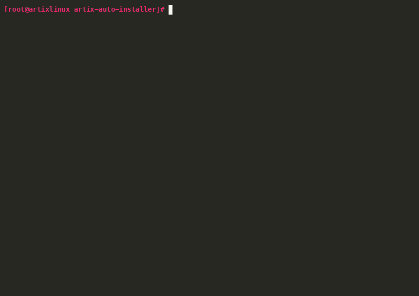
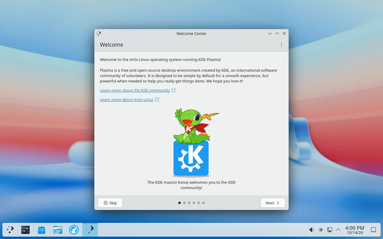
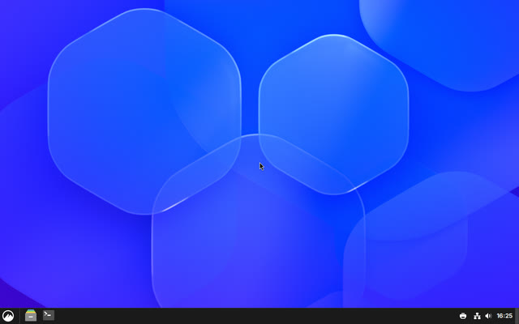
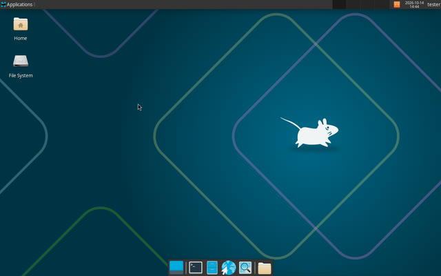
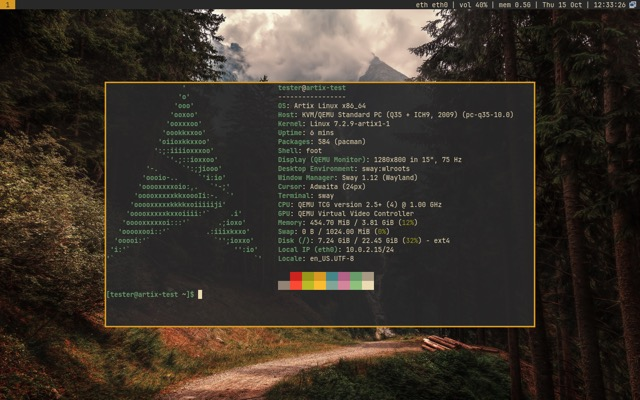
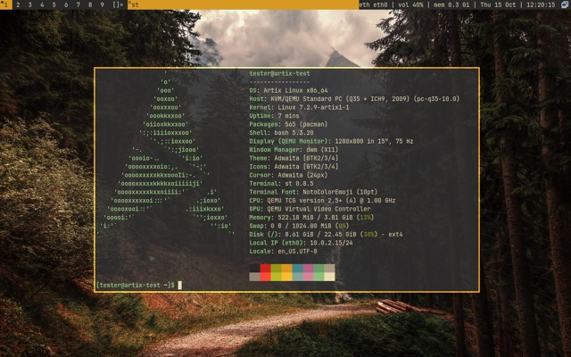

# Artix Auto Installer
Personal script for installing Artix Linux with Dinit on UEFI PCs/laptops.



After having installed Artix/Arch manually multiple times, I wanted to automate the installation, so I created this script.  
It asks a few questions (disk, user name, passwords, language, keyboard, desktop) and does the rest. The default language and keyboard layout are my own preferences, but you can change them during the installation.

[Artix](https://artixlinux.org) is a Linux distribution based on Arch Linux that doesn't use systemd. This script installs it with Dinit, the program that starts the system's background services.

The script is made for PCs and laptops with an Intel or AMD processor that start in UEFI mode, which is what almost every computer from the last ten years does.

The script will do the following:
- Find the fastest download servers (mirrors) for software, and use them during the installation and afterwards.
- Install Artix with an encrypted disk: nobody can read your files without the disk password, which you type every time the computer starts.
- Turn on a firewall that blocks all connections from outside, while your own programs can still connect to the internet.
- Show a summary at the end, with what to do next. You can save it in your home folder as `artix-install-summary.md`.
- Optionally:
  - Install a second, long-term support version of the Linux kernel. You can pick it in the boot menu if an update of the normal kernel ever causes problems.
  - Install NVIDIA's own graphics driver when the computer has an NVIDIA graphics card. The script picks the right driver for the card; cards from the GeForce GTX 750/900 series (2014) and newer are supported.
  - Switch to the older sound driver on laptops where the newer one gives no sound (the sound settings only show "Dummy Output"). The laptop's built-in microphones don't work with the older driver.
  - Turn on the AUR (Arch User Repository), a large collection of software made by other users, and install `yay` to install software from it. AUR software isn't checked by Artix or Arch, so only install what you trust.
  - Install a desktop (see below). Without one, the computer starts to a text screen where you log in and type commands.

## Desktops

The script can install one of these:

| Desktop | Login screen | What you get |
|---|---|---|
| KDE Plasma | yes (SDDM) | A complete, modern desktop, with KDE's terminal, file manager, text editor, archive manager, image and document viewers and screenshot tool |
| Cinnamon | yes (LightDM) | A traditional desktop, like Linux Mint's, with a terminal, archive manager, image viewer and sound and Bluetooth settings |
| XFCE | yes (LightDM) | A light, traditional desktop, with its extra apps and sound, network and Bluetooth settings |
| sway | your choice | My keyboard-driven [sway setup](https://github.com/tcvscheppingen/SARBS) (SARBS) |
| dwm | your choice | My keyboard-driven [dwm setup](https://github.com/tcvscheppingen/DARBS) (DARBS) |

<p align="center">
  <a href="assets/desktops/plasma.jpg"></a>
  <a href="assets/desktops/cinnamon.jpg"></a>
  <a href="assets/desktops/xfce.jpg"></a>
  <br>
  <a href="assets/desktops/sway.jpg"></a>
  <a href="assets/desktops/dwm.jpg"></a>
  <br>
  <sub>KDE Plasma, Cinnamon and XFCE; sway and dwm.</sub>
</p>

KDE Plasma, Cinnamon and XFCE also come with the LibreWolf web browser, Bluetooth, fonts for most languages and emoji, and the graphics drivers for Intel and AMD graphics. Sound and the network work right away with every desktop.

sway and dwm are window managers: you control the windows mostly with the keyboard. The script installs them with my own settings and look. They can start right after you log in on the text screen, or from a simple login screen in the same gruvbox colors; the script asks which you prefer.

A few limits:
- sway doesn't work with NVIDIA's own driver. With sway, the script leaves that driver out and uses the open nouveau driver instead; on a laptop that also has Intel or AMD graphics, sway uses those.
- GNOME is not offered, because it needs systemd, which Artix doesn't use.

## Usage

1. Download the Artix **base dinit** ISO from the [Artix download page](https://artixlinux.org/download.php) and put it on a USB stick, for example with [balenaEtcher](https://etcher.balena.io) or `dd`.
2. In the computer's firmware settings (often opened with F2, F12 or Delete right after turning it on), turn off Secure Boot, and start the computer from the USB stick in UEFI mode.
3. Log in as `root` with the password `artix`.
4. Connect to the internet. A network cable is easiest; Wi-Fi works with `connmanctl`.
5. Run these commands:

```bash
pacman -S git
git clone https://github.com/tcvscheppingen/artix-auto-installer.git
cd artix-auto-installer
chmod +x artix-install.sh
./artix-install.sh
```

The script erases the whole disk you choose; it asks you to type `ERASE` before it changes anything.

To answer some or all questions in advance, copy `install.conf.example`, fill it in and run `./artix-install.sh --config install.conf`. Anything you leave empty is still asked.

## Testing

This part is for people working on the script. `test/run-container-test.sh` tests the installer automatically with Docker: it runs the installer in an Artix container against a disk image, checks the installed system, and boots it in a virtual machine (QEMU, UEFI, NVMe) to check it from the inside.

```bash
test/run-container-test.sh                          # shellcheck, packages, install, verify, boot; no desktop
test/run-container-test.sh all --desktop plasma     # with a desktop: plasma, cinnamon, xfce, sway or dwm
test/run-container-test.sh all --desktop all        # every desktop in turn (takes hours)
test/run-container-test.sh report --desktop all     # write the reports again from the saved results
DARBS_DIR=~/src/DARBS test/run-container-test.sh all --desktop dwm    # a local DARBS checkout
SARBS_DIR=~/src/SARBS test/run-container-test.sh all --desktop sway   # a local SARBS checkout
```

Every run checks that the package lists of Plasma, Cinnamon and XFCE still exist in the Artix repos. Each desktop needs its own install, so `--desktop all` installs, checks and boots them one after another; a failing desktop doesn't stop the next one. With a desktop, the boot test logs in through the login screen the way a person would (it types the password with xdotool), checks the session, PipeWire and the sound card, and the report shows screenshots of the login screen and the desktop.

It works on macOS (Docker Desktop) and Linux (Docker Engine). The install and check stages need privileged containers, which on Linux share the host's kernel; the test only uses its own loop devices and device-mapper names, and doesn't change the host's EFI boot entries, clock, swap or console keymap.

Each desktop's logs, screenshots and report end up in `test/out/<desktop>/`, so runs for different desktops don't overwrite each other. `--desktop all` also writes `test/out/test-report.pdf`, with a summary of all desktops followed by each one's results. The reports are PDFs when pandoc and a TeX engine (xelatex, lualatex, pdflatex or tectonic) are installed, otherwise Markdown.

## Disclaimer
I wrote this script with assistance from a Large Language Model.   
Never run any scripts without checking the contents first.
