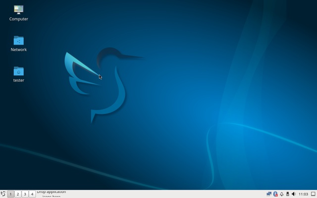

# Artix Auto Installer

My personal script to install Artix Linux with Dinit on UEFI PCs and laptops.


After installing Artix and Arch by hand multiple times, I wanted to automate the installation, so I wrote this script.
It asks you a few questions about the disk, your user name, passwords, language, keyboard layout and desktop, and it does the rest.
The default language and keyboard layout are my own preferences, but you can change them during the installation.

In short, [Artix](https://artixlinux.org) is a fork of Arch Linux that doesn't use SystemD. This script installs it with Dinit as the init system.
In simple terms: the init system is the piece of software that manages the background services of your system.
I personally like Dinit, because it is lightweight and not too difficult to use.

The script is made for PCs and laptops with an Intel or AMD processor that boot in UEFI mode. Almost every computer from the last ten years does.

## What the script does

- It finds the fastest download servers (mirrors) and uses them during the installation and afterwards.
- It encrypts your disk. Nobody can read your files without the disk password, which you type every time your computer boots.
- It turns on a firewall that blocks all incoming connections. Your own programs can still connect to the internet.
- It shows a summary at the end with the next steps. You can save it in your home folder as `artix-install-summary.md`.

You can also choose to:
- Install the long-term support (LTS) kernel as a second kernel. If an update of the normal kernel ever causes problems, you can pick the LTS kernel in the boot menu.
- Set up [Timeshift](https://github.com/linuxmint/timeshift). It takes a snapshot of your system every day and before every update, so you can undo an update that breaks something. Snapshots are removed after 5 days.
  Note that your home folder is not in the snapshots and the snapshots are on the same disk, so they don't replace a backup. See [Restoring a snapshot](#restoring-a-snapshot).
- Install NVIDIA's own driver if your computer has an NVIDIA graphics card. The script picks the right driver for your card. Cards from the GeForce GTX 750/900 series (2014) and newer are supported.
- Switch to the older sound driver on laptops where the newer one gives no sound and the sound settings only show _dummy output_. Note that the built-in microphones of the laptop don't work with the older driver.
- Enable the AUR (Arch User Repository) and install `yay`. The AUR is a large collection of software made by other users. AUR software isn't checked by Artix or Arch, so only install what you trust.
- Install a desktop (see below). Without one, your computer boots to a text console where you log in and type commands.

## Desktops

You can choose one of these:

| Desktop | Login screen | What you get |
|---|---|---|
| KDE Plasma | yes (SDDM) | A complete, modern desktop, with KDE's terminal, file manager, text editor, archive manager, image and document viewers and screenshot tool |
| Cinnamon | yes (LightDM) | A traditional desktop, like Linux Mint's, with a terminal, archive manager, image viewer and sound and Bluetooth settings |
| XFCE | yes (LightDM) | A light, traditional desktop, with its extra apps and sound, network and Bluetooth settings |
| LXQt | yes (LightDM) | A light, traditional desktop like XFCE, built with Qt, with a terminal, file manager, archive manager, image viewer, screenshot tool and sound, network and Bluetooth settings |
| sway | your choice | My keyboard-driven [sway setup](https://github.com/tcvscheppingen/SARBS) (SARBS) |
| dwm | your choice | My keyboard-driven [dwm setup](https://github.com/tcvscheppingen/DARBS) (DARBS) |

<p align="center">
  <a href="assets/desktops/plasma.jpg"></a>
  <a href="assets/desktops/cinnamon.jpg"></a>
  <a href="assets/desktops/xfce.jpg"></a>
  <br>
  <a href="assets/desktops/lxqt.jpg"></a>
  <a href="assets/desktops/sway.jpg"></a>
  <a href="assets/desktops/dwm.jpg"></a>
  <br>
  <sub>KDE Plasma, Cinnamon and XFCE; LXQt, sway and dwm.</sub>
</p>

The desktop environments (KDE Plasma, Cinnamon, XFCE and LXQt) also come with the LibreWolf browser, Bluetooth, fonts for most languages and emoji, and the drivers for Intel and AMD graphics.
Sound and network work right away with every desktop.

Sway and dwm are window managers: you control your windows mostly with the keyboard.
They use less memory and processor power than the desktop environments, so they are the lightest option, but they take some time to learn.
The script installs them with my own configuration. They can start right after you log in on the text console, or from a simple login screen in the same style. The script asks which one you prefer.

A few limitations:
- Sway doesn't work with NVIDIA's own driver. If you choose sway, the script uses the open source nouveau driver instead. On a laptop that also has Intel or AMD graphics, sway uses those.
- GNOME is not an option, because it needs SystemD.
- LXDE is not an option, because it is no longer developed. Its developers now work on LXQt.
- The boot partition (`/boot`, with the Linux kernel and the boot menu) is not encrypted and Secure Boot is turned off.
  The encryption protects your files if your computer is lost or stolen, but not against someone who changes the boot partition while you're away and then waits for you to type your disk password.

## Usage

1. Download the Artix **base dinit** ISO from the [Artix download page](https://artixlinux.org/download.php) and write it to a USB stick, for example with [balenaEtcher](https://etcher.balena.io) or `dd`.
2. Open the firmware settings of your computer. Usually you rapidly press a key like F2, F12 or DEL while the computer is booting. Turn off Secure Boot and boot from the USB stick in UEFI mode.
3. Log in as `root` with password `artix`.
4. Connect to the internet. An ethernet cable is the easiest. For WiFi you can use `connmanctl`.
5. Run the following commands:

```bash
pacman -Sy git
git clone https://github.com/tcvscheppingen/artix-auto-installer.git
cd artix-auto-installer
chmod +x artix-install.sh
./artix-install.sh
```

Don't update the live system with `pacman -Syu` before you run the script.
That replaces the Linux kernel package, so the running kernel can no longer load the modules that the disk encryption needs. The script will stop before it changes your disk.
If you did update, boot from the USB stick again and start over. The installed system gets the latest packages anyway.

The script erases the whole disk you choose. It asks you to type `ERASE` before it changes anything.

If you want to answer some or all of the questions in advance, copy `install.conf.example`, fill it in and run `./artix-install.sh --config install.conf`. Anything you leave empty will still be asked.

## Updating

Update your system with `sudo pacman -Syu`. I would recommend reading the [Artix news](https://artixlinux.org/news.php) first.

When an update has a new version of a config file that you (or the script) changed, pacman keeps your version and saves the new one next to it as `.pacnew`.
Merge those right after the update with `sudo pacdiff`, before you reboot. The script installs it for you.
An unmerged file in `/etc/pam.d` can stop turnstile from starting when you log in. PipeWire then doesn't start either, so you have no sound.

## Restoring a snapshot

If you set up Timeshift and an update broke something, you can go back to a snapshot from before the update.
Only the system files are restored, your home folder is not touched.
Save your work first, because you will need to restart your computer afterwards.

These are the commands to restore a snapshot:

```bash
# list the snapshots
sudo timeshift --list
# replace the name with the snapshot you want to restore
sudo timeshift --restore --snapshot '2026-10-27_09-00-01' --skip-grub
# when it says "Restore completed"
sudo reboot
```

Press Enter to keep the default answers and type `y` to confirm.
When Timeshift says _Restore completed_, restart your computer with `sudo reboot`.
Timeshift tries to restart it by itself, but that doesn't work on Artix. You can ignore the error it shows about that.
The `--skip-grub` option is important: the snapshot already contains the boot menu. Without it, Timeshift reinstalls GRUB in a way that doesn't match this installation.

### If your desktop still works

Open a terminal and run the commands above.
On KDE Plasma, Cinnamon, XFCE and LXQt you can also use the Timeshift app from the menu. Select a snapshot, click _Restore_ and turn off reinstalling GRUB under _Bootloader Options_.

### If your desktop doesn't start

If you are stuck on a black screen or the login screen doesn't work, press Ctrl+Alt+F2 to open a text console.
Log in with your user name and password and run the commands above.

If your computer doesn't boot at all after a kernel update, choose the LTS kernel in the boot menu (if you installed it). Then restore a snapshot from there.
If neither kernel boots, you will need the USB stick. The script doesn't cover restoring from a USB stick.

## Testing

This part is for people working on the script. I use `test/run-container-test.sh` to test the installer automatically with Docker.
It runs the installer in an Artix container on a disk image, checks the installed system, and boots it in a virtual machine (QEMU, UEFI, NVMe) to check it from the inside.

```bash
test/run-container-test.sh                          # shellcheck, packages, install, verify, boot; no desktop
test/run-container-test.sh all --desktop plasma     # with a desktop: plasma, cinnamon, xfce, lxqt, sway or dwm
test/run-container-test.sh all --desktop all        # every desktop in turn (takes hours)
test/run-container-test.sh report --desktop all     # write the reports again from the saved results
test/run-container-test.sh all --desktop all --full # a whole install for every desktop
test/run-container-test.sh all --desktop sway --nvidia  # keep NVIDIA's driver in a run with sway
DARBS_DIR=~/src/DARBS test/run-container-test.sh all --desktop dwm    # a local DARBS checkout
SARBS_DIR=~/src/SARBS test/run-container-test.sh all --desktop sway   # a local SARBS checkout
```

Every run checks whether the package lists of Plasma, Cinnamon, XFCE and LXQt still exist in the Artix repos.
With `--desktop all` the desktops are installed, checked and booted one after another. If one desktop fails, the next one still runs.

To save time, the installation without a desktop is kept as a base system, and the other desktops are installed on a copy of it. With `--full` every desktop gets a whole installation instead.
Runs that include sway leave out NVIDIA's driver, because sway doesn't support it. `--nvidia` keeps it.
Downloaded packages are cached in the Docker volume `artix-install-pkgcache`.

With a desktop, the boot test logs in through the login screen like a person would. It checks the session and the sound, and takes screenshots for the report.

The tests work on macOS (Docker Desktop) and Linux (rootful Docker Engine). Rootless Docker, Podman, userns-remap and the snap package don't work.
The install and check stages need privileged containers, which on Linux share the kernel of your computer.
The test only uses its own loop devices and device-mapper names, and doesn't change the EFI boot entries, clock, swap or console keymap of your computer.

The logs, screenshots and report of each desktop end up in `test/out/<desktop>/`, so runs for different desktops don't overwrite each other.
`--desktop all` also writes `test/out/test-report.pdf`, with a summary of all desktops followed by the results of each one.
The reports are PDFs if pandoc and a TeX engine (xelatex, lualatex, pdflatex or tectonic) are installed, otherwise Markdown.

## Disclaimer
I wrote this script with assistance from a Large Language Model.  

I came up with the idea and decided what the script installs and how. I wrote the README, made the dotfiles for [DARBS](https://github.com/tcvscheppingen/DARBS), reviewed all of the code and tested the script on my own hardware.  

The LLM built the automated tests, helped with debugging and fixing problems, made the dotfiles for [SARBS](https://github.com/tcvscheppingen/SARBS), created the social preview and checked the README for spelling and grammar. The desktop screenshots are made by the automated tests.

Never run any scripts without checking the contents first.
